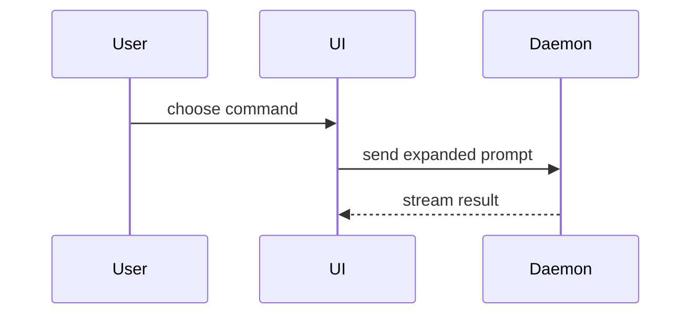

# Write the PR body

Adapted from [pr](https://github.com/mattpocock/skills/tree/main/skills/engineering/pr) by Matt Pocock. Its visual menu comes from [show-me](https://github.com/humanlayer/skills/blob/main/plugins/show-me/skills/show-me/SKILL.md) by Dex Horthy.

Use this template. For a visual change, embed the captured images in the Evidence table. For other changes, replace the table with the relevant measured output or test results.

```markdown
## Summary

<diagram, diff-sketch, or tree>

## Evidence

| Before | After |
| --- | --- |
|  |  |

<short caption: action, visible result, and capture conditions>

## Merge Danger

**Door:** <one-way or two-way>

<optional: description>

**Blast Radius:** <one-word description>

<optional: potential ramifications of merge>
```

For a stacked PR, add `## Stack` at the end. Link the parent PR and the child PRs.

Skip preambles. Keep prose brief. Use the domain terms of the repository. Read `GLOSSARY.md` when it exists.

## Summary

Pick the smallest view that makes the key point clear.

- Show logic or an algorithm as pseudocode:

```text
on(save)
  if content is unchanged
    return cached result
  write new content
  return fresh result
```

- Show runtime control flow as a call tree:

```text
submitForm
  createSession
    persistPrompt
    launchAgent
  navigateToSession
```

- Show UI structure as a component tree. Include the state and module boundaries that matter:

```text
<SessionPage> (apps/example/src/routes/session.tsx)
  useSessionEvents()
  <SessionToolbar>
    <RunSkillButton> (packages/ui)
```

- Show file responsibility or a broad refactor as a shallow file tree:

```text
src/
├── commands/       # parses user actions
├── sessions/       # owns session state
└── transport/      # sends API requests
```

- Show component interaction, control flow, or data flow with Mermaid:



- Use `diff` when the surrounding shape already exists and the point is what changes. Match the diff shape to the topic.

For a component change:

```diff
 <SessionPage>
   useSessionEvents()
   <SessionToolbar>
+    <RunSkillButton />
   <SessionTimeline>
+    <SkillResultCard />
```

For a file layout change:

```diff
 src/
 ├── commands/
+│   └── show-me.ts       # expands the slash command
 ├── sessions/
-└── transport.ts
+└── transport/
+    ├── client.ts
+    └── stream.ts
```

For a call tree change:

```diff
 submitForm
   createSession
     persistPrompt
+    expandSkillMention
     launchAgent
-  navigateToSession
+  navigateToSession
+    subscribeToEvents
```

For a state or control flow change:

```diff
 on(save)
-  write content
+  if content is unchanged
+    return cached result
+  write new content
+  invalidate cache
```

- Show the whole block when most of it is new, when omitted context hides ownership or order, or when the reviewer needs a copyable target shape:

```ts
function expandSkill(command: string): string {
  const skillName = command.slice(1);
  return `use the ${skillName} skill`;
}
```

Put each visual next to the short text it supports. Keep only the calls, files, props, states, and boundaries that the reviewer needs. You can use one visual or several. You will rarely use all of them. Use your judgment. Do not overwhelm the reviewer.

## Evidence

Show concrete proof that the change works. Show a before and an after.

### Visual changes

Capture the running application. Embed before and after screenshots in the PR body so reviewers can compare them directly. Written descriptions, mockups, diagrams, and test output do not replace captured visual evidence.

- Capture the before state from this PR's base. For a stacked PR, use the parent branch's exact tip. Capture the after state from this PR's changes.
- Use the same viewport, data, and interaction state for both captures. Label any necessary difference.
- Show the affected screen and enough context to judge the change. Include affected responsive layouts and relevant states, such as loading, empty, or error states.
- Use a short recording for motion, timing, or a sequence of actions. Label the before and after segments. Embed or link it beside the screenshots.
- Inspect each capture. Confirm that it shows the claimed change and belongs to this PR's slice.
- Use attachment URLs or artifact links that PR reviewers can access. Verify the links and image rendering in the PR. Local file paths do not provide evidence to reviewers.

Keep captions short. State the action and visible result. Add the viewport and setup details needed to reproduce the capture. Include only evidence that helps reviewers assess this slice.

If capture or attachment tools are unavailable, report the blocker before opening the PR. Do not substitute text or claim that visual evidence is complete.

### Other changes

Use actual test results, command output, or measurements. For a bug fix, show the exact test that failed before and passes after. For a new feature, show its observable result. Keep excerpts short and identify the command or test.

Report only checks that you ran. Report performance as `before → after` with units.

## Merge Danger

State the door type:

- A two-way door is cheap to roll back. It has lower risk.
- A one-way door is hard to reverse. Destructive actions, data migrations, and public contract changes are one-way doors.

State the blast radius. This is the possible impact of the PR. Consider all effects, such as layout shift, consumer breakage, and mobile layout.
